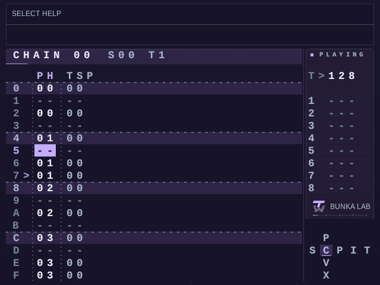

# TrackWerk

**An open-source tracker and sample studio for Android and Linux handhelds.**

TrackWerk brings sequencing, synthesis, sample editing, live performance and sound discovery to a button-driven handheld studio. Kid Bunka and contributors develop TrackWerk as an independent fork of [PocketTracker by conanizer and contributors](https://github.com/conanizer/pockettracker). The upstream tracker, sampler, editor, mixer and button workflow are the foundation.

[Website](https://kidbee85-beep.github.io/TrackWerk/) · [Illustrated field guide](https://kidbee85-beep.github.io/TrackWerk/guide.html) · [Download 1.0](https://github.com/kidbee85-beep/TrackWerk/releases/tag/v1.0.0) · [Watch the demonstration](https://kidbee85-beep.github.io/TrackWerk/#film) · [Optional support](https://www.paypal.com/donate/?business=kidbee85%40gmail.com&currency_code=CHF)

## Write, sample and perform

- Arrange across eight tracker tracks. Edit Chain and Phrase with independent Off, Beats, Grid and Dots settings.
- Discover archive recordings and live radio by source and genre. On supported connected profiles, replay recent radio audio and save an excerpt as WAV.
- Tap SELECT for help specific to the screen or tool. Radio playback continues while you read.
- Preview long WAV files from storage, select a range and edit the resulting sample with slicing, fades, declicking and gain tools.
- Play engine-specific synths, Gravity and Granular instruments. Build grooves from selected sounds in Drumlab, perform momentary Punch effects and use resampling in the arrangement.
- Shape the mix with categorized effects and mastering presets, headroom controls and stem or mix export.

## Devices and updates

| Device | Profile | Online sources |
| --- | --- | --- |
| Trimui Brick | KNULLI native port | Wi-Fi |
| Miyoo Mini Plus | Onion online build | Wi-Fi |
| Miyoo Mini | Onion offline build | Local audio |
| Powkiddy RGB20S | AmberELEC ARM64 port | Requires a supported external adapter |
| Android handhelds | Android 8+ APK, ARM64, ARMv7 and x86_64 | Device networking |

Use the Brick program updater or the shared Miyoo Mini and Mini Plus updater for an existing installation. The RGB20S port includes its own AmberELEC update instructions. Keep your data folder in place. For Android, use a package that matches your installed app identity and signing key. A migration from the earlier app identity starts with an export of app-private projects and samples. Use the [illustrated field guide](https://kidbee85-beep.github.io/TrackWerk/guide.html) for each installation route.

Audio input, display and controller behaviour depend on the device. Check the release notes for tested hardware and limitations. For audio you plan to share, check the source’s reuse terms.

## Source and credits

TrackWerk is distributed under GPL-3.0-or-later. See the [build instructions](BUILD-TRACKWERK.txt) and [application source](source/). The release includes the matching source ZIP, component licenses and exact Miyoo SDL source. Selected DSP work is based on open Mutable Instruments code by Emilie Gillet and contributors. See the [credits and licenses](https://kidbee85-beep.github.io/TrackWerk/credits.html).
