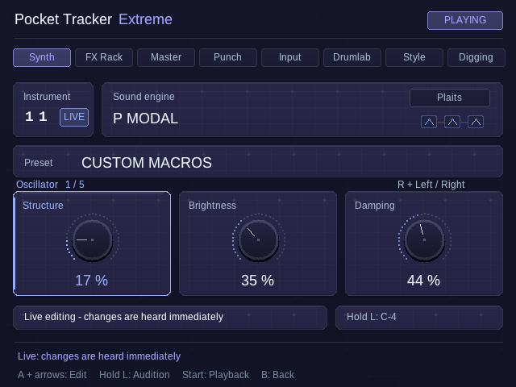

# TrackWerk

**A free, open-source music studio for Android and Linux handhelds.**

TrackWerk **0.9 beta**, by **Kid Bunka** and contributors, brings tracker sequencing, sample editing, synthesis, performance effects and online digging into one button-driven studio.

TrackWerk is an independent fork of **[PocketTracker by conanizer and contributors](https://github.com/conanizer/pockettracker)**. The upstream tracker, sampler, editor, mixer/export tools and established button workflow are its foundation. Kid Bunka’s TrackWerk work develops the expanded Studio, performance and archive workflows, visual identity and handheld fixes. Original authorship and component credits stay visible.

[Website](https://kidbee85-beep.github.io/TrackWerk/) · [Illustrated field guide](https://kidbee85-beep.github.io/TrackWerk/guide.html) · [Downloads](https://github.com/kidbee85-beep/TrackWerk/releases/tag/v0.9.0-beta) · [Watch the session](https://kidbee85-beep.github.io/TrackWerk/#film) · [Optional support](https://www.paypal.com/donate/?business=kidbee85%40gmail.com&currency_code=CHF)

## Make a track your way

- Eight tracker tracks, project swing, pattern/song arrangement and mix/stem export.
- Distinct synthesis engines with relevant controls, live editing and audition; 2,048 categorized instrument presets, including drums.
- Detailed sample editing, slicing, fades and declicking; long-WAV storage preview and range cropping into the editor.
- Internet Archive search, preview, IN/OUT selection, WAV rendering and import on supported connected profiles.
- Drumlab generation from your own selected sounds, followed by normal tracker editing.
- 64 momentary Punch choices in eight banks, internal post-FX resampling and import of the saved take.
- Categorized reverb, delay, Studio FX and mastering presets.
- 17 typefaces, 50 palettes, 18 materials and an independent TrackWerk visual identity.
- A supported M8 sampler/arrangement subset; unsupported engines/effects are reported and omitted.

## Platforms and updates

Android 8+ (ARM64, ARMv7, x86_64); Trimui Brick with KNULLI; Miyoo Mini and Mini Plus with Onion. The original Mini is offline; Mini Plus uses its separate online profile. R36S and Polyend Tracker Mini are outside this 0.9 release.

Linux program updates keep samples, projects, presets, themes, settings and controller mappings. Public TrackWerk Android has its own application identity and installs alongside earlier Pocket Tracker Extreme apps: export app-private work into a shared folder and leave the earlier app installed. The new app needs its own settings and folder grant. Future TrackWerk updates retain its identity and signature. **Do not uninstall, reflash or replace your whole data folder as an app-update step.** [Read the installation/update guide](https://kidbee85-beep.github.io/TrackWerk/guide.html#updates).

This is a beta. Final device acceptance is ongoing. Physical microphone and class-compliant audio-interface recording depend on device tests. Miyoo physical input is disabled. Direct iPhone-to-Brick USB capture failed in the tested setup and is not a supported claim. Online providers and rights vary; use material you are permitted to sample.

## Source and build

The complete application lives in [source/](source/). [BUILD-TRACKWERK-0.9.txt](BUILD-TRACKWERK-0.9.txt) explains Android, native Linux, preferred font/art sources and the Miyoo builders. Keep `source/`, `font-authoring/` and `brand-authoring/` together. The matching source ZIP and exact Miyoo SDL source accompany the release.

The repository is now TrackWerk. Legacy on-device data paths remain unchanged to preserve projects, samples and settings. The public product name is **TrackWerk**. Old release history remains available for reference.

## Credits and license

TrackWerk is an independent fork of [PocketTracker by conanizer and contributors](https://github.com/conanizer/pockettracker), under [GPL-3.0-or-later](source/LICENSE). Original authors and third-party notices retain their credits. Selected Mutable Instruments DSP by Emilie Gillet and dependencies keep their original licenses. These adaptations are not full hardware-module emulations. [Credits](source/CREDITS.md) · [Website credits](https://kidbee85-beep.github.io/TrackWerk/credits.html).

Public downloads exclude private sample libraries, private demo projects, signing keys and device identifiers. The new session film’s music/sample attribution is on the website and in its video description.
